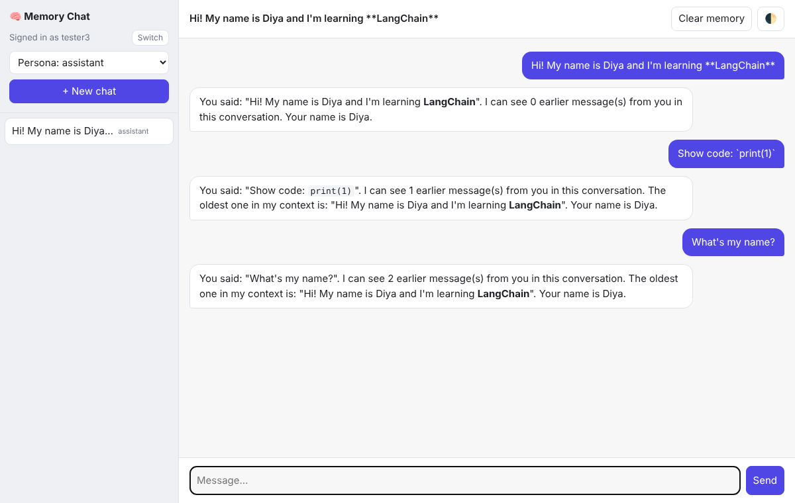
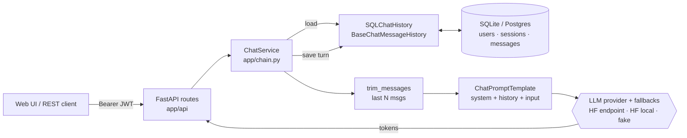
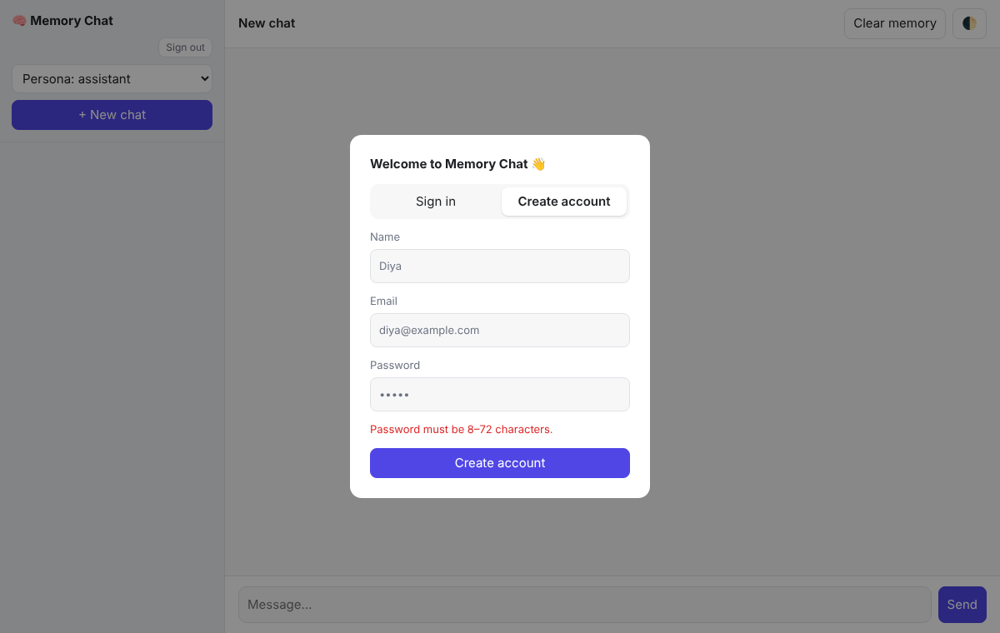

# 🧠 AI Chatbot with Conversational Memory

A multi-user, context-aware chatbot built with **LangChain**, **Hugging Face** and **FastAPI**.
Each user can have many chat sessions. Every session keeps its own persistent memory, so the bot
remembers what you said earlier in a conversation, even after the server restarts.



**Tech:** Python · LangChain · Hugging Face (Inference Providers / Transformers) · FastAPI · SQLAlchemy · JWT auth · REST + Server-Sent Events · pytest · Docker

## Features

- **Session-based conversational memory**: multi-turn, context-aware replies, persisted in SQL.
- **User accounts**: email + password sign-up/sign-in (bcrypt hashing, JWT bearer tokens).
- **Multi-user sessions**: each user owns their sessions; cross-user access is blocked.
- **Prompt templating** with LangChain `ChatPromptTemplate`: persona + user name + date + history.
- **Message-history management**: full history stored, sliding window (`trim_messages`) sent to the model.
- **Real-time streaming** responses over SSE, plus a standard JSON endpoint.
- **Pluggable LLM backends**: Hugging Face Inference Providers, local `transformers` pipeline, or an offline fake model.
- **Model fallback chain**: if a model isn't served by any enabled provider, the next one in `HF_MODEL_ID` is tried automatically (LangChain `with_fallbacks`).
- **Personas**: assistant, tutor, coder, interviewer (switchable per session).
- Auto-titled sessions, rename / clear / delete, a dark-mode web UI, an OpenAPI docs page, CI and Docker.

## Architecture



**Request flow for one turn:**
1. FastAPI verifies the user's JWT and checks they own the session.
2. `ChatService` loads that session's history from the DB through a custom LangChain `BaseChatMessageHistory`.
3. `trim_messages` keeps the last `MEMORY_WINDOW` messages, always starting on a user turn.
4. The `ChatPromptTemplate` renders the system prompt (persona, user name, date), the history and the new input.
5. The LLM generates a response (streamed token by token on `/api/chat/stream`).
6. The human and AI messages are persisted together, **only after the model succeeds**, so a failed call never leaves half a turn in memory.

```
app/
├── main.py            # App factory, lifespan (DB + LLM wiring), static UI
├── config.py          # Typed settings from env / .env (pydantic-settings)
├── security.py        # bcrypt password hashing, JWT issue/verify
├── db.py              # SQLAlchemy models: User, ChatSession, Message
├── memory/history.py  # SQL-backed LangChain chat history (per session)
├── chain.py           # ChatService: history -> trim -> prompt -> LLM -> persist
├── prompts.py         # ChatPromptTemplate + personas
├── llm/provider.py    # LLM factory + model fallback chain (hf_endpoint | hf_local | fake)
├── llm/fake.py        # Deterministic offline model (tests / demos)
├── schemas.py         # Pydantic request/response models
├── api/routes.py      # REST + SSE endpoints
├── api/deps.py        # Dependencies: DB, current user, ownership checks
└── static/index.html  # Web UI
tests/test_api.py      # 25 end-to-end API tests
```

## Quickstart

```bash
git clone https://github.com/Diyaisagrawal/ai-chatbot-memory.git
cd ai-chatbot-memory
python -m venv .venv && source .venv/bin/activate   # Windows: .venv\Scripts\activate
pip install -r requirements.txt
cp .env.example .env    # then put your HF_TOKEN in .env
uvicorn app.main:app --reload
```

Open http://127.0.0.1:8000, create an account (email + password) and start chatting. Interactive API docs are at http://127.0.0.1:8000/docs.



### Choosing an LLM backend (`LLM_PROVIDER`)

| Value | What it does | Needs |
|---|---|---|
| `hf_endpoint` *(default)* | Hugging Face Inference Providers via `ChatHuggingFace` + `HuggingFaceEndpoint` | Free `HF_TOKEN` ([create one](https://huggingface.co/settings/tokens) with "Make calls to Inference Providers") |
| `hf_local` | Runs `HF_LOCAL_MODEL_ID` locally with a `transformers` pipeline | `pip install -r requirements-local.txt` (a 0.5B model runs on CPU) |
| `fake` | Deterministic offline model that reports what's in its context | Nothing. Great for demos of the memory mechanism. |

`HF_MODEL_ID` is a comma-separated **fallback chain**. Which models Hugging Face serves changes over time, so if one returns *"not supported by any provider you have enabled"*, the next is tried. Browse currently served models [here](https://huggingface.co/models?inference_provider=all&pipeline_tag=text-generation), and choose which providers you use in [your inference provider settings](https://huggingface.co/settings/inference-providers). Gated models such as Llama require accepting the license on the model page first.

### Docker

```bash
docker build -t memory-chat .
docker run -p 8000:8000 --env-file .env -v chat-data:/app/data memory-chat
```

## REST API

Authenticate with `Authorization: Bearer <access_token>` (returned by register/login). Only the auth endpoints, `/api/personas` and `/health` are public.

| Method | Path | Description |
|---|---|---|
| `POST` | `/api/auth/register` | `{name, email, password}` → `{access_token, user}` |
| `POST` | `/api/auth/login` | `{email, password}` → `{access_token, user}` |
| `GET` | `/api/auth/me` | Current user |
| `GET` | `/api/personas` | Available personas |
| `POST` | `/api/sessions` | Create a session `{persona?, title?}` |
| `GET` | `/api/sessions` | List your sessions (most recent first) |
| `PATCH` | `/api/sessions/{id}` | Rename / change persona |
| `DELETE` | `/api/sessions/{id}` | Delete session and its memory |
| `GET` | `/api/sessions/{id}/messages` | Full stored history |
| `DELETE` | `/api/sessions/{id}/messages` | Clear memory, keep the session |
| `POST` | `/api/chat` | `{session_id, message}` → `{reply}` |
| `POST` | `/api/chat/stream` | Same, streamed as SSE: `data: {"token": ...}` … `data: {"done": true}` |

```bash
TOKEN=$(curl -s -X POST localhost:8000/api/auth/register -H 'Content-Type: application/json' \
     -d '{"name":"Diya","email":"diya@example.com","password":"supersecret1"}' | jq -r .access_token)
SID=$(curl -s -X POST localhost:8000/api/sessions -H "Authorization: Bearer $TOKEN" -H 'Content-Type: application/json' -d '{"persona":"tutor"}' | jq -r .id)
curl -s -X POST localhost:8000/api/chat -H "Authorization: Bearer $TOKEN" -H 'Content-Type: application/json' \
     -d "{\"session_id\":\"$SID\",\"message\":\"Hi, I'm Diya and I'm studying transformers\"}"
curl -s -X POST localhost:8000/api/chat -H "Authorization: Bearer $TOKEN" -H 'Content-Type: application/json' \
     -d "{\"session_id\":\"$SID\",\"message\":\"What am I studying?\"}"
```

## Testing

```bash
pip install -r requirements-dev.txt
pytest -q
```

The suite runs fully offline against the `fake` model and a temporary SQLite DB. It covers sign-up/sign-in (hashing, duplicate emails, wrong passwords, expired tokens), multi-turn memory, session isolation, cross-user access control, model fallbacks, window trimming vs. full persistence, memory surviving a restart, SSE streaming, failure handling (no orphaned messages) and prompt rendering. CI runs it on every push (GitHub Actions).

## Design decisions

- **Store everything, prompt a window.** Persisting all messages keeps history auditable and lets the UI show the full chat, while the sliding window bounds prompt size and latency. Counting *messages* instead of tokens keeps it model-agnostic.
- **Explicit history management instead of `RunnableWithMessageHistory`.** That helper is deprecated in LangChain 1.x. Loading, trimming and saving explicitly makes the memory flow easy to follow and lets us save a turn only after the LLM succeeds.
- **Custom `BaseChatMessageHistory` over SQLAlchemy.** It plugs into any LangChain component and works with SQLite locally or Postgres in production (just change `DATABASE_URL`).
- **Stateless JWT auth with bcrypt.** Passwords are never stored in plain text; login responses take the same time whether or not the email exists, so accounts can't be enumerated.
- **Ownership returns 404, not 403.** Session IDs can't be probed across users.
- **Fallback chain over a single model.** Hosted-model availability changes, so the app degrades gracefully instead of failing.
- **Provider factory.** Swapping between hosted, local and fake models is a config change; tests never hit the network.

## Roadmap

- Summary memory: summarize messages that fall out of the window into a running summary.
- Long-term semantic memory: embed past messages (`HuggingFaceEmbeddings`) and retrieve relevant ones (RAG over history).
- OAuth sign-in (Google / GitHub), email verification and password reset.
- Token-based trimming using the model's tokenizer; rate limiting.

## License

MIT
